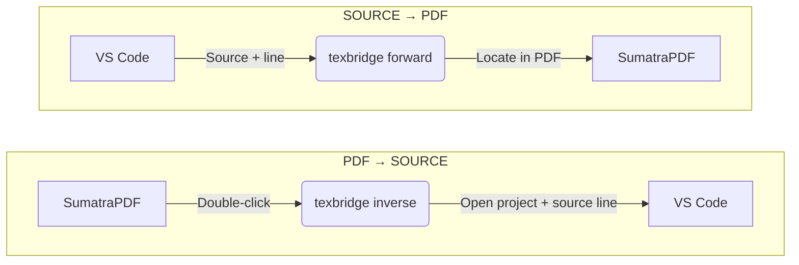

# 🌉 texbridge

A small Windows bridge for **VS Code ↔ SumatraPDF** SyncTeX navigation.
Automatic app discovery, simple configuration, and no background service.

**Your settings stay yours:** configure the applications manually using this README.
texbridge never edits application settings or manages auxiliary files.

## 🧼 Stateless by design

- **No saved configuration, discovery cache, or log files.** texbridge does not
  persist application state between calls.
- **No background service.** Each invocation handles one command and exits.
- **Application settings hold your choices.** `--code` and `--sumatra` are not
  remembered between calls; set them in the application commands if needed.
- **Fresh discovery when needed.** Navigation uses explicit executable arguments
  when provided; otherwise it searches PATH and common install locations again.

This applies to texbridge's own application state. uv still manages its tool
environment and installation cache, and Python may create bytecode caches.

## 🔄 How it works



Compile with `-synctex=1` to produce a PDF and its matching SyncTeX file.
SumatraPDF uses SyncTeX to map between source lines and PDF positions.
texbridge forwards navigation arguments and handles process launching. It may
read SyncTeX input-file records to find a project folder, but does not compute
page positions or stay running between jumps.

## 🚀 Install

Requires Windows, Python 3.11+, uv, Git, VS Code with LaTeX Workshop, and SumatraPDF.

```powershell
uv tool install "git+https://github.com/shunnli/texbridge.git"
```

Command not found? Run `uv tool update-shell` and reopen your terminal.
Update with `uv tool upgrade texbridge`.

## ⚙️ Configure once

Choose either version below: without paths for automatic app discovery, or
with explicit paths if discovery fails or multiple installations exist.
Existing working settings, including `--gui`, remain compatible.

### 1. VS Code: `settings.json`

Run **Preferences: Open User Settings (JSON)** from the command palette.
Merge one of these versions into your existing settings; preserve unrelated keys.
Project settings can override user settings.

**Without paths** — requires `texbridge` on PATH; SumatraPDF is discovered automatically.

```json
{
  "latex-workshop.view.pdf.viewer": "external",
  "latex-workshop.view.pdf.external.viewer.command": "texbridge",
  "latex-workshop.view.pdf.external.viewer.args": [
    "view", "--pdf", "%PDF%"
  ],
  "latex-workshop.view.pdf.external.synctex.command": "texbridge",
  "latex-workshop.view.pdf.external.synctex.args": [
    "forward", "--source", "%TEX%", "--line", "%LINE%", "--pdf", "%PDF%"
  ]
}
```

**With paths** — replace the example paths with your actual installation paths.
Use `/` in JSON paths to avoid backslash escaping.

```json
{
  "latex-workshop.view.pdf.viewer": "external",
  "latex-workshop.view.pdf.external.viewer.command": "C:/Users/YourName/.local/bin/texbridge.exe",
  "latex-workshop.view.pdf.external.viewer.args": [
    "view", "--sumatra", "C:/Apps/SumatraPDF/SumatraPDF.exe",
    "--pdf", "%PDF%"
  ],
  "latex-workshop.view.pdf.external.synctex.command": "C:/Users/YourName/.local/bin/texbridge.exe",
  "latex-workshop.view.pdf.external.synctex.args": [
    "forward", "--sumatra", "C:/Apps/SumatraPDF/SumatraPDF.exe",
    "--source", "%TEX%", "--line", "%LINE%", "--pdf", "%PDF%"
  ]
}
```

### 2. SumatraPDF: `SumatraPDF-settings.txt`

Open **Settings → Advanced Options**, then add or update these top-level entries
using one of the following versions.

**Without paths** — requires `texbridge` on PATH; VS Code is discovered automatically.

```text
EnableTeXEnhancements = true
ReuseInstance = true
ReloadModifiedDocuments = true
InverseSearchCmdLine = texbridge inverse --source "%f" --line %l
```

**With paths** — replace the example paths with your actual installation paths.
Point to `Code.exe`, not `code.cmd`.

```text
EnableTeXEnhancements = true
ReuseInstance = true
ReloadModifiedDocuments = true
InverseSearchCmdLine = "C:/Users/YourName/.local/bin/texbridge.exe" inverse --code "C:/Apps/VS Code/Code.exe" --source "%f" --line %l
```

Keep `%PDF%`, `%TEX%`, `%LINE%`, `%f`, and `%l` exactly as shown: the applications
substitute them when you navigate. Always keep quotes around `%f`.
To locate `texbridge.exe`, run `(Get-Command texbridge).Source` in PowerShell.
Restart both applications after changing PATH; update explicit paths if you move
an installation.

Successful navigation is silent; invalid arguments and launch failures appear
in a dialog. The legacy `--gui` flag is accepted and ignored for compatibility;
it is no longer needed in configuration.

### 3. Build and verify

Compile with `-synctex=1`, keeping the matching `.synctex` or `.synctex.gz` beside
the PDF. If synchronization fails, check that this file exists, is nonempty,
and comes from the same build as the PDF.

- **Forward:** place the cursor on a source line that produces PDF text, then
  run **LaTeX Workshop: SyncTeX from cursor** from **Ctrl+Shift+P**.
- **Inverse:** double-click the corresponding body text in SumatraPDF. VS Code
  should open the source at the matching line.

Test both with Sumatra already open and with Sumatra initially closed, so the
forward command starts it.

## 🧭 Navigation operations

These operations are intended for VS Code and SumatraPDF to invoke:

| Operation | Purpose |
| --- | --- |
| `texbridge view --pdf main.pdf` | Open a PDF |
| `texbridge forward --source chapter.tex --line 42 --pdf main.pdf` | Jump to PDF |
| `texbridge inverse --source chapter.tex --line 42` | Jump to source |

`--line` must be a positive integer. `view` and `forward` accept `--sumatra`;
`inverse` accepts `--code` and an optional `--pdf` for project discovery.
Quote file paths containing spaces in command strings.

There are no `config`, `doctor`, help (`-h` / `--help`), version, or dry-run
commands/options. Running without an operation or with unsupported arguments
shows an error dialog pointing to this README. Configuration instructions live
here rather than in terminal output.

## 📂 Open the project on inverse search

Inverse search tries to open a project folder together with the source line:

1. Use the nearest Git root above the source file, including Git worktrees.
2. Otherwise, look for a nearby PDF whose SyncTeX input list contains that source.
   If all matches share one folder, open that folder (or its enclosing Git root).
3. If no match is found or multiple folders match, open only the source file.

The search checks up to five source ancestor directories and their `build`,
`out`, and `output` folders. It is bounded, read-only, and uncached; it does not
scan `.aux` folders. An unrelated PDF with the same filename is not enough.

Sumatra's standard inverse command does not supply the PDF path. When calling
the tool yourself, you can provide it explicitly to skip PDF discovery:

```powershell
texbridge inverse --source 'D:/Paper/chapters/intro.tex' --line 42 --pdf 'D:/Paper/main.pdf'
```

The tool passes `--new-window`, the folder, and the source location in one call.
VS Code first matches an already-open project folder; otherwise it opens a new
window instead of replacing an unrelated window. The tool does not inspect
which files are already open. The single-file fallback retains `--reuse-window`
behavior.

## 🔎 Known limits

- Local Windows only; no WSL, SSH, or container path translation.
- LaTeX Workshop may supply a PDF path that does not match the current TeX
  source. For `view` and `forward`, texbridge uses the supplied path and checks
  that the file exists, but does not verify or correct the source-to-PDF match.
  This can open the wrong PDF or cause forward search to fail.
- Project-window matching follows VS Code's behavior; exact
  routing to an existing multi-root workspace is not guaranteed.
- The reported **“Sumatra must be opened independently”** issue is not yet
  verified as fixed. Test both an independently opened Sumatra and one started
  through VS Code. A successful process launch does not prove navigation worked.

## 🛠️ Development

From a local checkout:

```powershell
uv venv
uv pip install --python .venv/Scripts/python.exe -e .
.venv/Scripts/python.exe -m unittest discover -s tests -v
```

Install your checkout with `uv tool install .`; reinstall changes with
`uv tool install --reinstall .`. Runtime dependencies: standard library only.
Tests mock app launches and do not change application settings.

## 📚 References

Official documentation:

- [SumatraPDF LaTeX integration](https://www.sumatrapdfreader.org/docs/LaTeX-integration)
  — editor configuration, inverse-search placeholders, and troubleshooting.
- [SumatraPDF command-line arguments](https://www.sumatrapdfreader.org/docs/Command-line-arguments)
  — `-forward-search`, `-inverse-search`, and instance reuse.
- [SumatraPDF commands](https://www.sumatrapdfreader.org/docs/Commands)
  — command-palette actions, including inverse-search setup.
- [VS Code CLI](https://code.visualstudio.com/docs/configure/command-line)
  — `--goto` and `--reuse-window` semantics.
- [uv tools guide](https://docs.astral.sh/uv/guides/tools/)
  — isolated tool installation, command discovery, and upgrades.

Issue reports and compatibility context:

- [LaTeX Workshop #4800](https://github.com/James-Yu/LaTeX-Workshop/issues/4800)
  — inverse-search failure after a VS Code update and a reported fix using
  `Code.exe -r -g` instead of the old `cli.js` invocation.
- [LaTeX Workshop #637](https://github.com/James-Yu/LaTeX-Workshop/issues/637)
  — inverse search working when Sumatra is opened independently, but failing
  when started by VS Code.
- [SumatraPDF #5594](https://github.com/sumatrapdfreader/sumatrapdf/issues/5594)
  — reported SyncTeX regression in 3.6.1; configuration is not the only possible
  cause of navigation failures.
- [SumatraPDF SyncTeX security advisory](https://github.com/sumatrapdfreader/sumatrapdf/security/advisories/GHSA-jf4v-rw66-j4w2)
  — argument injection through inverse search; context for strict input handling.

The bridge uses public CLI flags and clears inherited `ELECTRON_RUN_AS_NODE`.
These are compatibility measures, not a proven fix for every reported issue.
