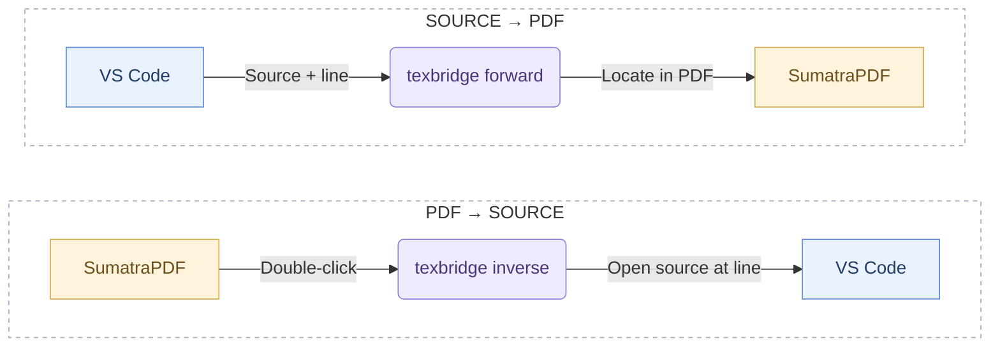

# 🌉 texbridge

A small Windows bridge for **VS Code ↔ SumatraPDF** SyncTeX navigation.
Automatic app discovery, simple configuration, and no background service.

**Your settings stay yours:** texbridge only prints configuration instructions.
It never edits application settings or manages auxiliary files.

## 🧼 Stateless by design

- **No saved configuration, discovery cache, or log files.** texbridge does not
  persist application state between calls.
- **No background service.** Each invocation handles one command and exits.
- **`config` only prints to the terminal.** Even `--code` and `--sumatra` are not
  remembered; copy the generated settings into the two applications yourself.
- **Fresh discovery when needed.** Navigation uses explicit executable arguments
  when provided; otherwise it searches PATH and common install locations again.

This applies to texbridge's own application state. uv still manages its tool
environment and installation cache, and Python may create bytecode caches.

## 🔄 How it works



Compile with `-synctex=1` to produce a PDF and its matching SyncTeX file.
SumatraPDF uses SyncTeX to map between source lines and PDF positions.
texbridge forwards navigation arguments and handles process launching; it does
not parse SyncTeX or stay running between jumps.

## 🚀 Install

Requires Windows, Python 3.11+, uv, Git, VS Code with LaTeX Workshop, and SumatraPDF.

```powershell
uv tool install "git+https://github.com/shunnli/texbridge.git"
texbridge config
```

Command not found? Run `uv tool update-shell` and reopen your terminal.
Update with `uv tool upgrade texbridge`.

## ⚙️ Configure once

### 1. Generate your configuration

```powershell
texbridge config
```

Apps are discovered from PATH and common install locations. The output contains
a VS Code JSON block and a separate SumatraPDF inverse-search command. Use the
output from your installed tool so the paths match your machine.

Only specify paths if discovery fails or finds multiple installations:

```powershell
texbridge config --code 'C:\Apps\VS Code\Code.exe' --sumatra 'C:\Apps\SumatraPDF\SumatraPDF.exe'
```

### 2. VS Code: `settings.json`

Merge these fields into your existing settings object. These examples assume
`texbridge` is available on PATH:

```json
{
  "latex-workshop.view.pdf.viewer": "external",
  "latex-workshop.view.pdf.external.viewer.command": "texbridge",
  "latex-workshop.view.pdf.external.viewer.args": [
    "view", "--gui", "--pdf", "%PDF%"
  ],
  "latex-workshop.view.pdf.external.synctex.command": "texbridge",
  "latex-workshop.view.pdf.external.synctex.args": [
    "forward", "--gui", "--source", "%TEX%", "--line", "%LINE%", "--pdf", "%PDF%"
  ]
}
```

Replace existing matching keys; preserve unrelated settings. Project-level
settings can override user settings, so keep matching entries consistent.

### 3. SumatraPDF: `SumatraPDF-settings.txt`

Add or update these top-level entries:

```text
EnableTeXEnhancements = true
ReuseInstance = true
ReloadModifiedDocuments = true
InverseSearchCmdLine = texbridge inverse --gui --source "%f" --line %l
```

Keep `%PDF%`, `%TEX%`, `%LINE%`, `%f`, and `%l` exactly as shown: the applications
substitute them when you navigate. The examples use automatic app discovery;
`texbridge config` instead prints ready-to-copy settings with discovered app
paths pinned through `--sumatra` and `--code` for predictable GUI launches.

If either application cannot find `texbridge`, replace that command with the
full path to `texbridge.exe`. In the Sumatra command, quote the executable path:
`"path/to/texbridge.exe" inverse --gui --source "%f" --line %l`.

Both applications use the same `texbridge.exe` entry point. `--gui` displays
output and errors in a dialog; successful navigation is silent. Omit it for
terminal output. The executable uses the Windows GUI subsystem, so launching
it from SumatraPDF does not create a console window. Without `--gui`, it uses
inherited output streams or attaches to the calling terminal; it never creates
a new console. If no terminal or redirected output exists, it uses a dialog.
If installation paths change, rerun `config` and update your settings manually.

After upgrading from an older console launcher, reinstall the tool and rerun
`texbridge config`. Existing executable launchers must be replaced for this fix
to take effect; changing the Python source alone is not enough.

### 4. Build and verify

Compile with `-synctex=1`, keeping the matching `.synctex` or `.synctex.gz` beside
the PDF. Then check your actual PDF path:

```powershell
texbridge doctor --pdf 'D:\Paper\main.pdf'
```

- **Forward:** place the cursor on a source line that produces PDF text, then
  run **LaTeX Workshop: SyncTeX from cursor** from **Ctrl+Shift+P**.
- **Inverse:** double-click the corresponding body text in SumatraPDF. VS Code
  should open the source at the matching line.

Test both with Sumatra already open and with Sumatra initially closed, so the
forward command starts it. `doctor` alone does not confirm either navigation path.

## 🧭 Commands

| Command | Purpose |
| --- | --- |
| `texbridge config` | Print configuration instructions |
| `texbridge view --pdf main.pdf` | Open a PDF |
| `texbridge forward --source chapter.tex --line 42 --pdf main.pdf` | Jump to PDF |
| `texbridge inverse --source chapter.tex --line 42` | Jump to source |
| `texbridge doctor --pdf main.pdf` | Check app paths and SyncTeX file presence |

Use `--help` for options. Add `--dry-run` to `view`, `forward`, or `inverse`
to inspect arguments without launching an app.
Use `--gui` with any command to display its output in a dialog instead of the
terminal. It can appear before or after the subcommand.

## 🔎 Known limits

- Local Windows only; no WSL, SSH, or container path translation.
- Inverse search reuses the most recently active VS Code window.
- `doctor` checks files and paths, not SyncTeX contents or actual navigation.
- The reported **“Sumatra must be opened independently”** issue is not yet
  verified as fixed. Test both an independently opened Sumatra and one started
  through VS Code. A successful process launch does not prove navigation worked.

## 🛠️ Development

From a local checkout:

```powershell
uv venv
uv pip install --python .venv/Scripts/python.exe -e .
.venv/Scripts/python.exe -m unittest discover -s tests -v
```

Install your checkout with `uv tool install .`; reinstall changes with
`uv tool install --reinstall .`. Runtime dependencies: standard library only.
Tests mock app launches and do not change application settings.

## 📚 References

Official documentation:

- [SumatraPDF LaTeX integration](https://www.sumatrapdfreader.org/docs/LaTeX-integration)
  — editor configuration, inverse-search placeholders, and troubleshooting.
- [SumatraPDF command-line arguments](https://www.sumatrapdfreader.org/docs/Command-line-arguments)
  — `-forward-search`, `-inverse-search`, and instance reuse.
- [SumatraPDF commands](https://www.sumatrapdfreader.org/docs/Commands)
  — command-palette actions, including inverse-search setup.
- [VS Code CLI](https://code.visualstudio.com/docs/configure/command-line)
  — `--goto` and `--reuse-window` semantics.
- [uv tools guide](https://docs.astral.sh/uv/guides/tools/)
  — isolated tool installation, command discovery, and upgrades.

Issue reports and compatibility context:

- [LaTeX Workshop #4800](https://github.com/James-Yu/LaTeX-Workshop/issues/4800)
  — inverse-search failure after a VS Code update and a reported fix using
  `Code.exe -r -g` instead of the old `cli.js` invocation.
- [LaTeX Workshop #637](https://github.com/James-Yu/LaTeX-Workshop/issues/637)
  — inverse search working when Sumatra is opened independently, but failing
  when started by VS Code.
- [SumatraPDF #5594](https://github.com/sumatrapdfreader/sumatrapdf/issues/5594)
  — reported SyncTeX regression in 3.6.1; configuration is not the only possible
  cause of navigation failures.
- [SumatraPDF SyncTeX security advisory](https://github.com/sumatrapdfreader/sumatrapdf/security/advisories/GHSA-jf4v-rw66-j4w2)
  — argument injection through inverse search; context for strict input handling.

The bridge uses public CLI flags and clears inherited `ELECTRON_RUN_AS_NODE`.
These are compatibility measures, not a proven fix for every reported issue.
